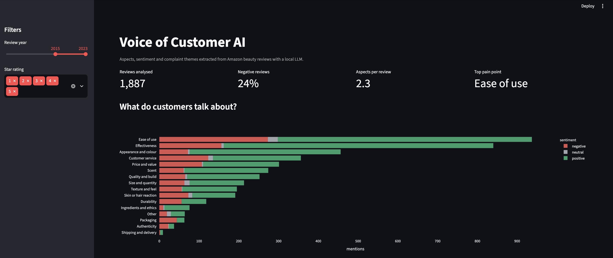
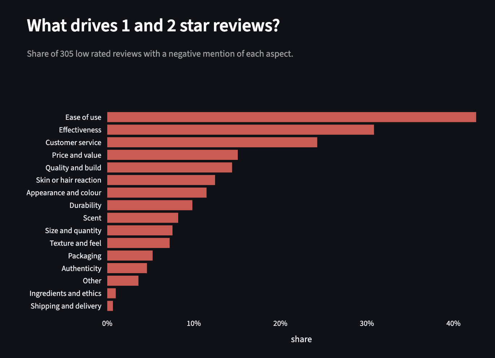
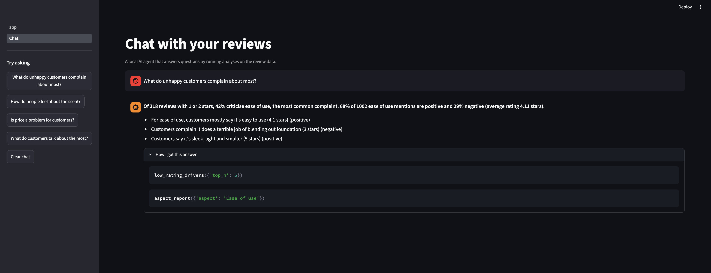

# Voice of Customer AI

Turn thousands of product reviews into structured, decision ready insights using a local LLM.



## The business problem

Star ratings tell you **that** customers are unhappy, but not **why**. Reading thousands of reviews by hand does not scale. This project uses an LLM to read every review and extract:

- which product **aspects** the customer talks about (scent, packaging, price, effectiveness and more)
- the **sentiment** towards each aspect, with an evidence phrase copied from the review
- the customer's **main complaint** in one sentence

The results feed an interactive dashboard that answers questions like *"What drives our 1 and 2 star reviews?"*

## Dashboard

- **What do customers talk about?** Aspect mentions split by sentiment
- **Net sentiment by aspect:** where the product wins and where it loses
- **What drives 1 and 2 star reviews?** Share of low rated reviews with a negative mention per aspect
- **Evidence explorer:** drill down from any chart to the actual customer quotes



## How it works

```
Amazon reviews → load_data.py → extract.py (local LLM) → run_extraction.py → Streamlit dashboard
```

## Key design choices

| Choice | Why |
|---|---|
| **Local LLM** (Qwen 2.5 3B via Ollama) | Free and private: no review text leaves the machine. The model is a single setting in `config.py`, so switching to a larger or cloud model is a one line change. |
| **Structured output** with a Pydantic schema | Ollama forces every answer into a fixed JSON format, so there are no parsing failures. |
| **Fixed aspect taxonomy with definitions** | Free text labels ("smell", "fragrance", "odour") cannot be counted. A fixed list makes the output analysable. |
| **Grounding check** | Every evidence phrase must appear in the original review, otherwise the aspect is dropped. This filters hallucinated labels. |
| **Checkpointing and resume** | Results are written after every review, so a long batch run can stop and continue without losing work. |
| **Reproducibility** | Fixed random seed for sampling and temperature 0 for the model. |

## Evaluation and iteration

Automated labels are only useful if they are correct, so the output was checked manually by sampling 15 random mentions per aspect.

**Version 1** (12 aspects) had low precision for some categories: about 2 of 15 correct for *Authenticity* and about 7 of 15 for *Ease of use*. The review showed the cause was the taxonomy, not the model: there were no categories for appearance, build quality or ingredients, so the model forced those mentions into the wrong box.

**Version 2** added *Appearance and colour*, *Quality and build*, *Ingredients and ethics* and *Customer service*, tightened the definitions, and added a rule that generic praise ("love it") gets no aspect.

Version 2 spot check: *Ease of use* X of 15 correct, *Customer service* X of 15 correct.

**Limitations:** a 3B parameter model still over-tags some aspects. Next steps are a hand labelled evaluation set with precision and recall per aspect, and a comparison with larger models.

## Chat with your reviews (AI agent)



A local AI agent answers plain English questions by calling analysis tools on the extracted data, instead of guessing. Every answer shows which tools were used ("How I got this answer").

**Tools:** `aspect_report` (sentiment and quotes for one aspect), `low_rating_drivers` (what drives 1 and 2 star reviews), `list_aspects` (what customers talk about).

**Making a 3B model reliable at tool calling.** The first version followed a multi step prompt badly: it skipped tools, gave no numbers and picked the wrong tool when a question said "examples". The fixes moved logic from the prompt into code:
- **Higher level tools:** one tool per question type, so the model makes one decision instead of chaining several
- **Fewer tools:** a tool that kept being chosen wrongly was removed
- **Numbers computed in code:** each tool returns a ready made headline with percentages
- **Guardrail:** code checks that the headline is in the final answer and adds it if the model skipped it

**Limitation:** the model sometimes paraphrases quotes instead of copying them word for word.

## Data

[Amazon Reviews 2023](https://amazon-reviews-2023.github.io/) (McAuley Lab, UC San Diego), *All Beauty* category. A random sample of 2,000 reviews with at least 40 characters, from 2002 to 2023. The data is not included in this repo; `load_data.py` downloads it.

## Project structure

```
voice-of-customer-ai/
├── app/app.py               # Streamlit dashboard
├── src/
│   ├── config.py            # model name and aspect taxonomy
│   ├── load_data.py         # streams and samples the reviews
│   ├── extract.py           # LLM prompt, schema and grounding check
│   ├── run_extraction.py    # batch run with checkpointing
│   ├── test_extract.py      # quick quality test on 10 reviews
│   └── check_aspects.py     # manual label spot check
└── requirements.txt
```

## How to run

1. Install [Ollama](https://ollama.com) and download the model:
   ```bash
   ollama pull qwen2.5:3b
   ```
2. Set up Python:
   ```bash
   python3 -m venv .venv
   source .venv/bin/activate
   pip install -r requirements.txt
   ```
3. Load the data and run the extraction (about 1.5 hours for 2,000 reviews on a MacBook):
   ```bash
   python src/load_data.py
   python src/run_extraction.py
   ```
   Use `--limit 50` for a quick test run.
4. Start the dashboard:
   ```bash
   streamlit run app/app.py
   ```

## Roadmap

- [ ] **Chat with your reviews:** an agent that answers questions using tool calls over the extracted data
- [ ] **Trend tracking** with Bayesian credible intervals, so small changes are not overinterpreted
- [ ] **Evaluation set** with precision and recall per aspect
- [ ] Comparison of local and larger models on quality, speed and cost
